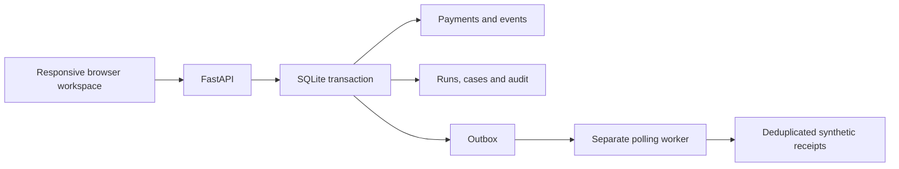

# Payment operations console

## Run and demonstrate

Use Python 3.12, `pip install -r requirements-dev.txt`, and
`uvicorn app.main:app --reload`. In another terminal run `python -m app.worker`.
Both processes must point to the same local `DATABASE_PATH`. Alternatively,
`docker compose up --build` starts both with a shared named volume at `/app/data`.
The existing free Render service only runs the web process and has ephemeral data;
its notifications will queue unless a worker with access to the same database is
started. Do not configure a separate cloud worker with an independent SQLite file.

1. Click **Explore a sample scenario**. It creates two successful payments and one
   pending payment through real API requests. Repeat it: the request keys reuse the
   records. All amounts and merchant references are synthetic.
2. Compare the supplied CSV. One row matches; another is ten rupees below the
   internal amount. Save the investigation to persist the snapshot and a case.
3. Add an investigation note and resolve the case. Inspect its decision history;
   payment records do not change. Reload and reopen it. A stale version is rejected
   with 409 so two browser tabs cannot silently overwrite each other's decision.
4. Refresh operations after running the worker. Notification jobs show delivered.
   The destination is a local receipt table, not a real email or payment provider.
5. Run `python -m pytest tests/test_operations.py -q` to demonstrate a deliberately
   injected crash after delivery but before acknowledgement, then lease expiry and
   recovery without a second receipt.

## Architecture and invariants

- Payment/event changes and corresponding notification intent commit together.
- The worker claims a job with a 30-second lease, commits a local receipt, then
  acknowledges delivery in a separate transaction. A crash can cause redelivery;
  the receipt primary key suppresses the duplicate effect. This is at-least-once
  processing, not an exactly-once external messaging guarantee.
- Five attempts maximum; simulated failures back off exponentially. Expired final
  attempts become exhausted. There is no automatic replay of exhausted jobs.
- `BEGIN IMMEDIATE` serializes SQLite writers. The scope is one machine/shared
  local disk, not a horizontally scaled distributed deployment.
- A normalized CSV fingerprint is unique within a session. Identical reuploads
  return the original snapshot even if payments have changed. Use the read-only
  Compare action for a fresh comparison; saving is deliberately archival.
- Investigations have an optimistic version check. Every accepted decision has
  a note and timestamp. The app exposes no audit-edit route; this is not a
  tamper-proof regulatory audit store.
- All new reads and case changes check the bearer demo session scope. Tokens live
  in browser sessionStorage. They are not verified identities, passwords or RBAC.
- Maximum 100 payments, 50 saved runs, 100 CSV rows and 50 decisions per case per
  demo scope. These are demo bounds, not a service-wide anti-abuse system.
- Schema v2 is additive and idempotent. Existing payments/events remain intact;
  startup serializes new table creation. Back up the SQLite file before upgrades.

## Verification evidence

44 automated API tests passed locally on 5 November 2026. Eight new checks cover
upload replay, optimistic edits and history, cross-session isolation, restart
persistence, concurrent upload, malformed input rollback, crash recovery and retry
exhaustion. Original payment/event/reconciliation checks also pass. A browser check
exercised seeded data, CSV mismatch, saved case, resolution, reload, search,
zero-value feedback, repeat seeding and mobile overflow; no JavaScript errors.
Screenshots: [desktop](operations-desktop.png), [mobile](operations-mobile.png).
These are functional results, not measured throughput, uptime or security certification.

## Resume and explanation

The following describes the implemented artifact, with AI assistance explicit:

> AI-assisted Payment Operations Console — FastAPI, SQLite, JavaScript, Docker
> - Synthetic payment workspace with idempotent requests, event deduplication,
>   saved settlement investigations, version-checked resolutions and audit history.
> - Transactional notification outbox with leased retries and duplicate suppression;
>   44 automated API checks cover reliability, persistence and session isolation.

Use this scope only after personally reviewing and explaining it. Codex implemented
and ran this release's checks at Aadesh's request; the test count does not establish
his independent authorship or mastery. Do not claim PostgreSQL, real payments,
production authentication, external webhook integration or the updated live URL.

Practice: trace a request-key replay; explain why file fingerprint replay is a
snapshot; identify the crash window between receipt and acknowledgement; show why
two case updates need a version; distinguish an app restart from loss of a hosted
ephemeral filesystem. Then own a small tested change, such as a new read-only
filter, and explain the failing/passing case.

Implementation references: [Python SQLite transactions](https://docs.python.org/3/library/sqlite3.html)
and [FastAPI testing](https://fastapi.tiangolo.com/tutorial/testing/).
